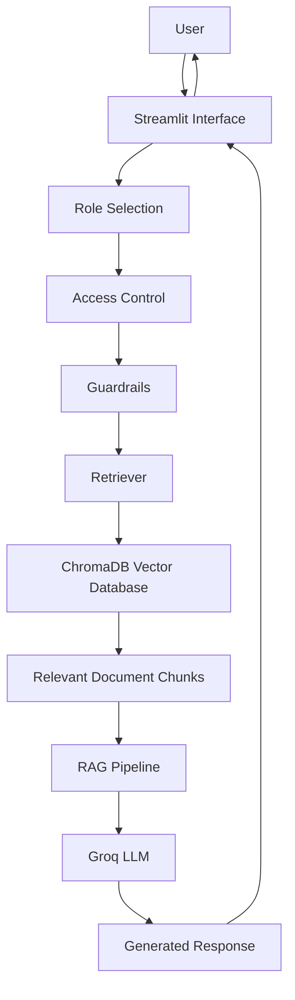

# Enterprise RAG Chatbot for Private Company Data with Role-Based Access Control (RBAC)

## 1. Project Overview

The **Enterprise RAG Chatbot** is an AI-powered question-answering system designed to retrieve and generate answers from internal company documents.

It uses Retrieval-Augmented Generation (RAG) to provide context-aware responses while implementing Role-Based Access Control (RBAC) to restrict document access based on user roles.

The project demonstrates how organizations can build an internal knowledge assistant that helps employees retrieve relevant information from company policies.

## 2. Key Features

- **Retrieval-Augmented Generation (RAG):** Retrieves relevant information from company documents before generating answers.
- **Role-Based Access Control (RBAC):** Restricts document retrieval based on the selected user role.
- **Document Processing:** Loads and splits company policy documents into smaller chunks.
- **Vector Database:** Uses ChromaDB to store document embeddings and retrieve relevant content.
- **Semantic Search:** Uses Sentence Transformers for document embeddings.
- **LLM Integration:** Uses Groq-hosted language models to generate responses.
- **Guardrails:** Includes checks to handle restricted or out-of-scope queries.
- **Monitoring and Evaluation:** Includes modules for tracking chatbot activity and evaluating responses.

## 3. Technology Stack

| Category | Technology |
|---|---|
| Programming Language | Python |
| Frontend | Streamlit |
| RAG Framework | Custom Python RAG Pipeline |
| Embedding Model | all-MiniLM-L6-v2 |
| Vector Database | ChromaDB |
| LLM Provider | Groq |
| Containerization | Docker |
| Testing | Pytest |

## 4. Project Status

This project currently uses sample company policy documents to demonstrate RAG and role-based document retrieval. Production authentication, deployment, and enterprise-grade security are future improvements.

## 5. System Architecture

The chatbot follows a Retrieval-Augmented Generation workflow.



### Workflow

1. The user enters a question through the Streamlit interface.
2. The user selects a role for the demonstration.
3. Access control determines which documents the selected role can retrieve.
4. Guardrails check the incoming query.
5. The retriever searches the permitted documents in ChromaDB.
6. Relevant document chunks are passed to the RAG pipeline.
7. The Groq-hosted LLM generates an answer using the retrieved context.
8. The response is displayed to the user.

## 6. Document Access Rules

| User Role | Accessible Documents |
|---|---|
| General | Company Policy |
| HR | Company Policy, HR Policy |
| Finance | Company Policy, Finance Policy |

*Note: Role selection is currently a demonstration mechanism, not production authentication.*

## 7. Project Structure

```text
Enterprise-RAG-Chatbot/
│
├── data/
│   └── documents/
│       ├── company_policy.txt
│       ├── finance_policy.txt
│       └── hr_policy.txt
│
├── logs/
│   ├── evaluation_results.json
│   └── monitoring.jsonl
│
├── src/
│   ├── access_control.py
│   ├── app.py
│   ├── document_loader.py
│   ├── evaluation.py
│   ├── guardrails.py
│   ├── main.py
│   ├── monitoring.py
│   ├── rag_pipeline.py
│   ├── retriever.py
│   ├── text_chunker.py
│   └── vector_store.py
│
├── tests/
├── .streamlit/
├── .dockerignore
├── .gitignore
├── Dockerfile
├── requirements.txt
└── README.md
```

*Note: The `chroma_db/`, `.env`, and generated log files are kept out of Git using `.gitignore`.*

## 8. Installation and Setup

### Prerequisites

- Python 3.12
- Git
- Docker (optional, for containerized execution)
- Groq API key

### Step 1: Clone the Repository

```bash
git clone https://github.com/YOUR_USERNAME/Enterprise-RAG-Chatbot.git
cd Enterprise-RAG-Chatbot
```

### Step 2: Create a Virtual Environment

```bash
python3 -m venv venv
source venv/bin/activate
```

### Step 3: Install Dependencies

```bash
pip install -r requirements.txt
```

### Step 4: Configure Environment Variables

Create a `.env` file in the project root:

```env
GROQ_API_KEY=your_groq_api_key
```

Replace the placeholder with your own Groq API key. Never commit your `.env` file or share your API key.

### Step 5: Build the Vector Database

```bash
python src/vector_store.py
```

### Step 6: Run the Application

```bash
streamlit run src/app.py
```

Open the local URL displayed in the terminal to access the chatbot.

## 9. Docker Setup

### Build the Docker Image

```bash
docker build -t enterprise-rag-chatbot .
```

### Run the Container

```bash
docker run -d \
  --name rag-demo \
  -p 8080:8080 \
  --env-file .env \
  enterprise-rag-chatbot
```

Open:

```text
http://localhost:8080
```

### Stop the Container

```bash
docker stop rag-demo
```

### Remove the Container

```bash
docker rm rag-demo
```

## 10. Testing and Validation

The project includes automated tests using Pytest.

### Test Results

- **Total tests passed:** 27
- **Failed tests:** 0
- **Testing framework:** Pytest

Run the test suite using:

```bash
python -m pytest -v
```

The tests cover:

- Role-based document access
- Guardrail functionality
- Document retrieval
- RAG evaluation
- Monitoring functionality

### Manual Testing

The chatbot was manually tested with different roles:

| Role | Test Scenario |
|---|---|
| Finance | Retrieve reimbursement policy information |
| HR | Retrieve leave policy information |
| General | Retrieve IT support information |

## 11. Current Limitations

- Uses sample company policy documents rather than real enterprise data.
- Role selection is demonstration-only and does not provide production authentication.
- Guardrails use heuristic checks and require further security improvements.
- The project has not yet been deployed to a production cloud environment.
- Monitoring and evaluation require further development for production-scale usage.

## 12. Future Improvements

- Implement secure user authentication and authorization.
- Integrate enterprise document sources.
- Improve PII detection and sensitive-data protection.
- Strengthen guardrails against prompt injection and unauthorized requests.
- Deploy the application to Microsoft Azure.
- Add automated evaluation and monitoring during deployment.
- Introduce token usage and cost tracking with alerts.
- Improve scalability and production reliability.


